# AI-SNS v3.3 — SNS 시뮬레이션 (React Native + Expo · X 스타일)

> 원본 앱 **status – 심즈 같은 SNS**(WishRoll)의 기능·화면 흐름을 재현한 공부용 클론입니다(예전 이름: 메인캐).
> v3.3 핵심: **연애 수위(순한맛/보통/매콤함) 직접 조절**, **좋아하는 티 반응을 더 현실적·귀엽게**, **쪽지 대화가 길어지면 AI가 맥락을 요약해 기억**.
> v3.2: **모두가 내 말에 쉽게 휩쓸림(크게 기뻐하고 호감도 크게 오름)**, **플러팅에 적극 반응·한 단계 더 나감(설렘·암시까지)**, **스탯 3개 = 호감도·설렘·정복도 + 슬라이더**, **이벤트 답 → 여러 인물 수치 변화 + 댓글 달린 실제 SNS 반응 글**, **세계관 전체 수정 화면**.
> v3.1: 틀 문장 0개(전부 AI가 맥락 보고 씀) · 반응 다발 최대 8개 · 하루 넘기기 즉시 · 모델별 한 판 요금 · 유명인 24명·사진 DB 저장.
> 기본 세계관의 등장인물·프로필 사진은 전부 가상 인물입니다. 실존 인물은 앱이 만들지 않고, 사용자가 [공통 캐릭터](#9-공통-캐릭터)에 직접 넣어 씁니다.

## 이 문서에서 찾기

| 궁금한 것 | 섹션 |
|---|---|
| 지금 바로 실행하려면? | [1. 실행하기](#1-실행하기) |
| v3.1에서 뭐가 바뀌었나? | [2. 바뀐 점](#2-바뀐-점-v31--v32) |
| 코드는 어떤 층으로 나뉘나? | [3. 앱 구조](#3-앱-구조) |
| 글을 올리면 내부에서 무슨 일이? | [4. 글 하나가 처리되는 흐름](#4-글-하나가-처리되는-흐름) |
| 관계·말투는 언제 바뀌나? | [5. 관계·말투 규칙](#5-관계말투-규칙) |
| AI는 몇 번 부르고 얼마 드나? | [6. AI 연결·토큰·요금](#6-ai-연결토큰요금) |
| 데이터는 어디에 저장되나? | [7. 저장·동기화](#7-저장동기화-supabase-aisns) |
| 아이템·스탯 조정은? | [8. 아이템·스탯 조정](#8-아이템스탯-조정) |
| 내가 만든 계정을 여러 세계관에 넣으려면? | [9. 공통 캐릭터](#9-공통-캐릭터) |
| 세계관·사진은? | [10. 세계관·사진](#10-세계관사진) |
| 숫자 규칙은? | [11. 게임 규칙 수치](#11-게임-규칙-수치) |
| 파일은 어디에? | [12. 폴더 구조](#12-폴더-구조) |
| 확인한 것·아직 안 되는 것은? | [13. 검증·알려진 한계](#13-검증알려진-한계) |

**도식 색 범례**: 🟨 노랑 = 입력(플레이어 행동) · 🟦 파랑 = 데이터(저장) · 🟩 초록 = 처리(규칙·AI) · 🟪 보라 = 출력(화면에 보이는 결과)

---

## 1. 실행하기

| 방법 | 필요한 것 | 순서 |
|---|---|---|
| **폰 앱** (추천) | PC에 [Node.js LTS](https://nodejs.org), 폰에 **Expo Go** | ① `START.bat` 더블클릭 → ② `1` → ③ QR을 Expo Go(안드로이드) 또는 카메라(아이폰)로 찍기 |
| **폰 앱 (와이파이 다를 때)** | 위와 같음 | `START.bat` → `2` (터널 모드) |
| **PC 브라우저** | Node.js | `START.bat` → `3` |
| **claude.ai 웹 페이지** | 설치 없음 | 아티팩트 링크 열기 (AI = 제미나이(DB 경유) → 클로드 순, DB = Supabase 커넥터) |
| 맥·리눅스 | Node.js | `npm install` → `npx expo start` |

- **`.env.local`** 에 Gemini 키·Supabase 주소·동기화 코드가 들어 있습니다. **남에게 코드를 줄 땐 이 파일을 빼고** `.env.example` 만 주세요.
- Expo SDK 57 · 폰과 PC가 **같은 와이파이**여야 `1`번이 됩니다.
- **AI 키가 없으면 캐릭터들이 반응하지 않습니다**(틀 문장으로 대신 채우지 않음). 나 탭 → AI 연결에서 키를 넣으세요.
- 이 버전을 처음 실행하면 `START.bat`이 캐시를 한 번 비우고 시작합니다(지워진 파일이 남지 않게).

<p>
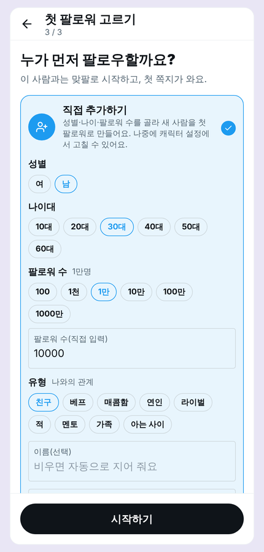 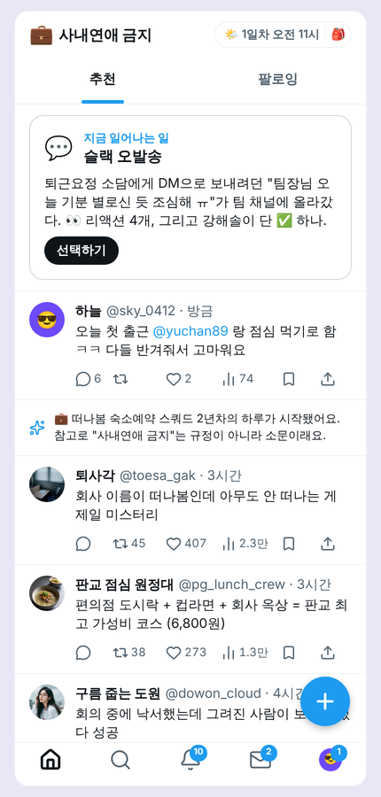 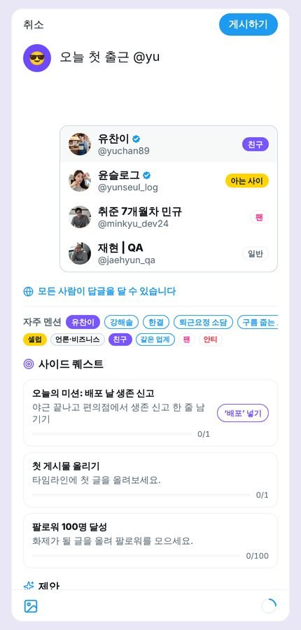 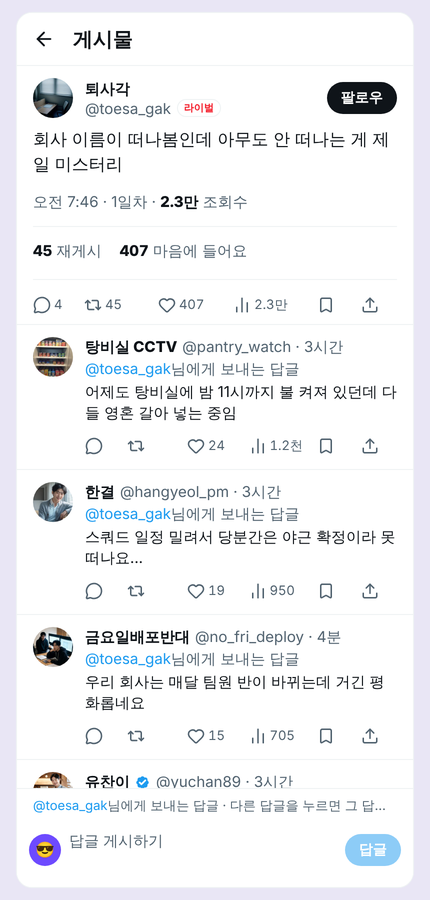 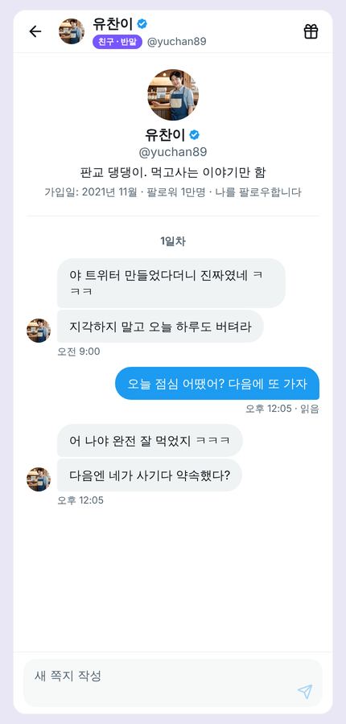 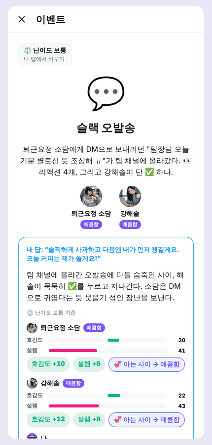
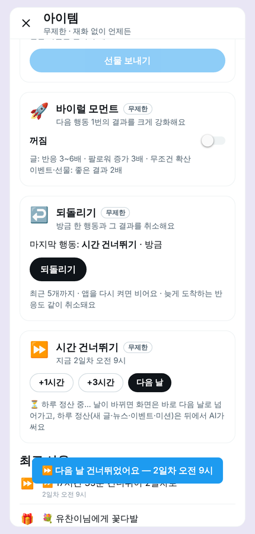 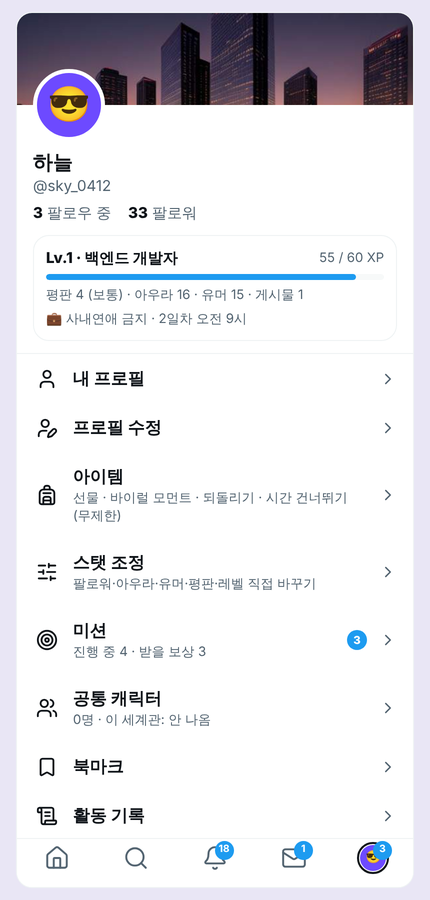 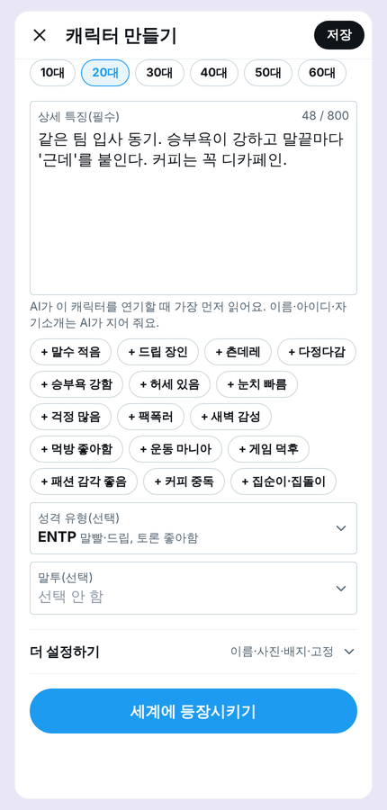 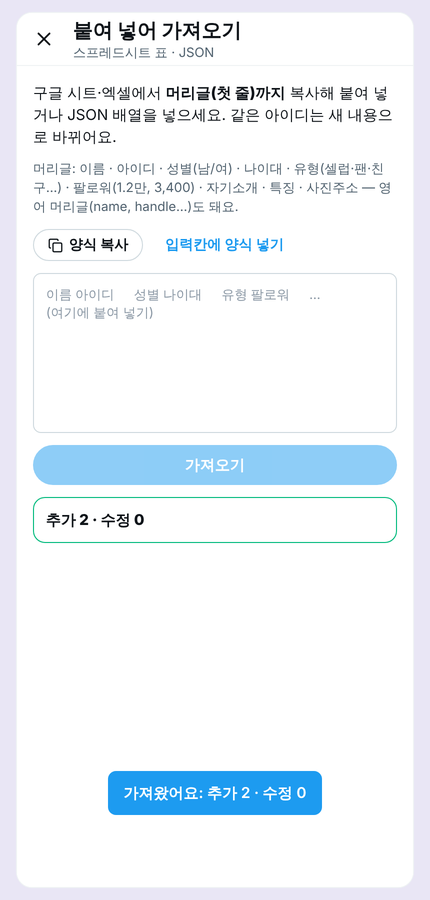 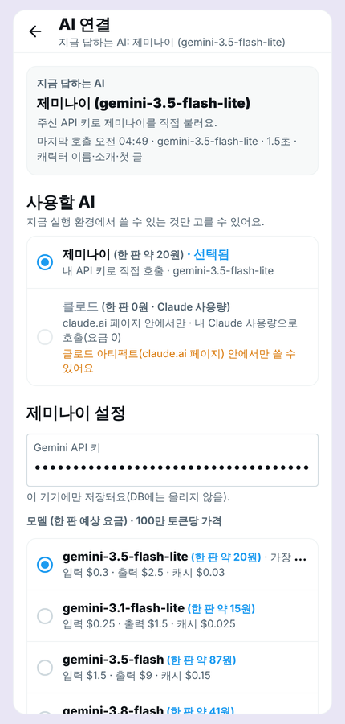 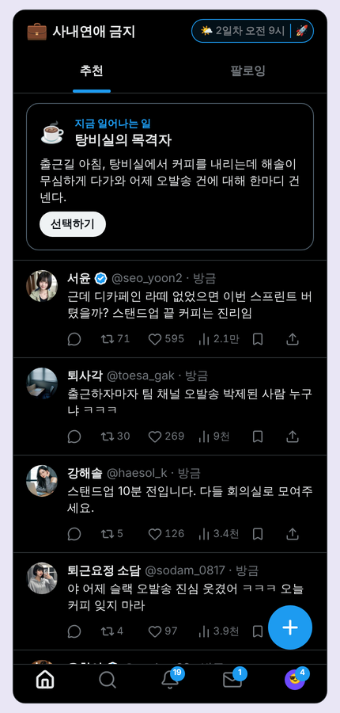
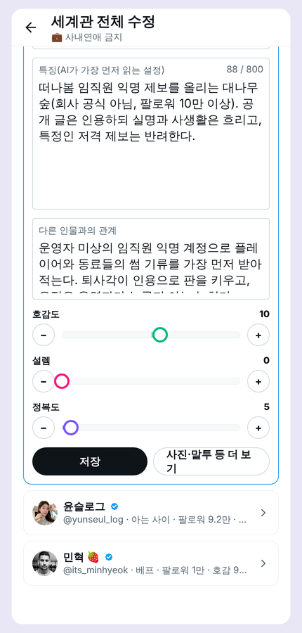 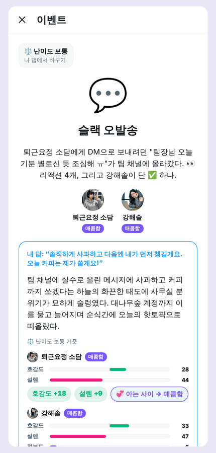
</p>

## 2. 바뀐 점 (v3.1 → v3.2)

| # | 요청 | 결과 | 어디서 |
|---|---|---|---|
| 1 | 내 말에 다들 더 쉽게 휩쓸리게 | AI 지시문에 **"반응의 온도"** 규칙: 대단한 일엔 모두 크게 놀라고 팬은 열광, 라이벌·안티도 인정할 건 인정 · 반박은 플레이어가 무례하거나 틀렸을 때만 · 호감도 폭 확대(글 반응 최대 +15, 이벤트 최대 ±25) · 난이도 배율 상향(보통: 이벤트 ×1.5, 쪽지·글 ×1.4) | `src/ai/prompts.ts` · `difficulty.ts` |
| 1 | 플러팅에 적극 반응 | 플러팅은 대부분 반가워함 · 이미 설렘이 있으면 **한 단계 더**(능청·애교·직진·질투) · 아직이면 당황하면서 속으로 좋아함 · 정색·거절·"소름" 금지(무례할 때 빼고) · 설렘 상승 폭 확대(쪽지 최대 +12). **수위는 설렘·밀당·스킨십 암시까지**(노골적인 성 묘사·신체 품평 없음) · 실존 인물일 수 있는 공통 캐릭터와 가족은 연애 반응 없음 | 〃 |
| 1-2 | 스탯 3개 + 슬라이더 | **호감도(-100~100) · 설렘(0~100) · 정복도(0~100)**. 캐릭터 → 수정하기 → `관계 수치`에서 끌거나 −/+(5씩)로 조절. 정복도가 높을수록 부탁을 기꺼이 들어주고 먼저 더 해 줌(응원·홍보·선물·시간 내주기). 열혈 팬은 40, 팬은 20에서 시작 | 캐릭터 프로필·편집 |
| 2 | 이벤트 답 = 시스템 글 X | 댓글 없는 시스템 글 삭제 → 답 내용에 맞게 **3~8명의 호감도·설렘·정복도 변화** + 인물·일반인이 그 일에 대해 **SNS 글 2~4개(각 댓글 1~3개)** 를 올림. 댓글 없는 글은 버림 | 이벤트 → 홈 |
| 1 | 말투 안전망 오류 | 감탄사 한마디에 "~요"가 붙던 것("네?" → "네요?", "어…" → "어요…") 수정 | `src/ai/local/register.ts` |
| 3 | 사진 품질 | 이번엔 그대로(나중에 사용자가 직접 다시 만들 예정) | — |
| 4 | 세계관 전체 수정 | 나 탭·설정 → **세계관 전체 수정**: 세계관(이름·한 줄 소개·설정·분위기·용어) · 내 계정 · 인물 목록(인증 계정/핵심 인물/전체) — 인물마다 접고 펼쳐 이름·아이디·성별·나이대·유형·팔로워·배지·소개·특징·관계·수치 3개 수정 | 나 탭 |

## 2-1. 바뀐 점 (v3.2 → v3.3)

| # | 요청 | 결과 | 어디서 |
|---|---|---|---|
| 1 | 연애 수위를 내가 직접 조절 | 나 탭에 **연애 수위(🌶️ 순한맛/보통/매콤함)** 3단계 설정 추가. AI가 판단해 고정하는 게 아니라 사용자가 직접 올리고 내림. 매콤함도 설렘·밀당·스킨십 **암시**까지이고, **노골적인 성 묘사·신체 묘사는 세 단계 모두 쓰지 않음**(코드에 고정, 설정으로 못 풀림) · **실존 인물일 수 있는 공통 캐릭터(`celeb_…` 등)와 가족은 이 설정과 무관하게 연애·성적 반응 0** — 조절 대상에서 항상 제외 | `src/game/content.ts` · `src/ai/prompts.ts`(`[연애 수위]` 블록) · 나 탭 |
| 2 | 좋아할 때 반응을 더 현실적·귀엽게 | 드라마 대사처럼 거창하게 티 내지 않고, "자꾸 핸드폰 봄"·"그 말 듣고 괜히 웃음"처럼 사소하고 구체적인 디테일로 표현 | `src/ai/prompts.ts` |
| 3 | 대화가 길어지면 맥락 기억 | 쪽지 한 대화방이 **16줄 넘게** 길어지면, 그 앞부분을 AI가 요약해 보관(최대 260자) → 다음 대화부터 "이전 요약 + 최근 16줄"로 맥락 유지. 이전엔 12줄보다 앞선 내용은 완전히 버려졌음(요약 자체가 없었음) | `src/game/dm.ts` · `src/ai/prompts.ts`(`sum` 필드) |

**분명히 선 긋는 것**: "상업용이니 노골적 묘사도 넣어 달라"는 요청은 반영하지 않았습니다. 성 묘사·신체 묘사 금지와 실존 인물(공통 캐릭터) 연애·성적 반응 제외는 **사용자 설정으로도 못 바꾸는 고정 규칙**입니다. 대신 사용자가 직접 조절 가능한 부분(수위 3단계, 정복도 연동)은 전부 설정으로 열어 뒀습니다.

## 3. 앱 구조

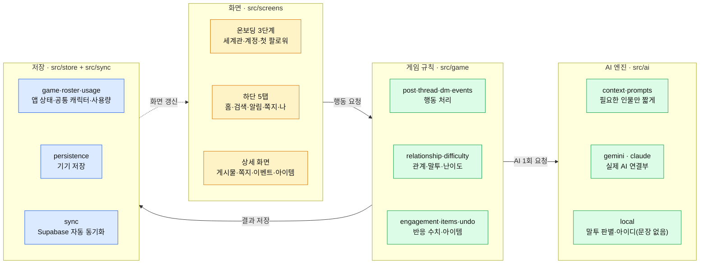

- **AI는 글만 쓰고, 숫자는 게임 규칙이 정합니다**(범위 제한·난이도 배율). 관계·말투도 게임 규칙이 정해서 AI에게 "이 말투로"라고 알려 줍니다.
- **기기는 문장을 만들지 않습니다.** 답글·댓글·쪽지·글·뉴스·제안은 전부 AI가 씁니다(기본 세계관의 시작 전 지난 글·첫 이벤트만 세계관 파일에 인물별로 직접 쓴 것).
- 기기에 먼저 저장(오프라인 가능) → 바뀐 세이브만 DB로 올립니다.

## 4. 글 하나가 처리되는 흐름

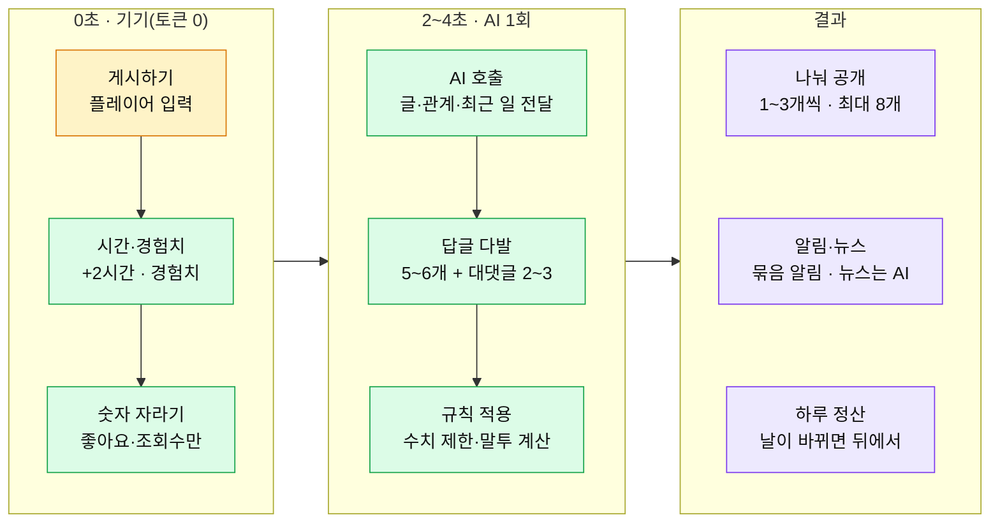

| 행동 | AI 호출 | 비고 |
|---|---|---|
| 새 이야기 시작 | 1회 | 첫 팔로워의 첫 쪽지(그 인물 말투로, 입력 중… 뒤 한 줄씩). 직접 만든 세계관은 첫 하루 정산 1회 더 |
| 글 올리기 | 1회 | 답글 기본 5~6개 + 인플루언서 대댓글 2~3개(최대 8) |
| 내 답글 | 1회 | 상대(또는 마지막 답글 단 사람)가 되받아침 |
| 쪽지 | 1회 | 답장 1~3줄을 한 줄씩(입력 중 표시) |
| 이벤트 선택·직접 답하기 | 1회 | 결과 문장 + 3~8명 수치 + 반응 글 2~4개(댓글 포함). 결과가 비면 이벤트는 그대로 대기 |
| 남의 글 처음 열기 | 1회 | 다시 열기 0회 · 작성자 팔로워 50%↑ 늘면 2~3개 더(1회) |
| 하루 정산 | 1회(뒤에서) | 캐릭터 글·뉴스·트렌드·이벤트·미션·제안. 나갔다 돌아온 사람의 첫마디도 여기서 |
| 글쓰기 제안·다른 제안 | 0회 | AI가 다른 반응에 얹어 보낸 제안만 모아 두고 돌려 보여 줌 |
| 다른 이벤트 | 0~1회 | 세계관 파일의 이벤트(0회) → 바닥나면 AI 1회 |
| AI 실패 | — | 같은 AI로 한 번 더 → 다음 AI → 그래도 안 되면 **비워 둠**(알림만) |

## 5. 관계·말투 규칙

| 항목 | 규칙 (`src/game/relationship.ts`) |
|---|---|
| 호감도 띠 | 적 < -55 ≤ 라이벌 < -15 ≤ 아는 사이 < 35 ≤ 친구 < 75 ≤ 베프 |
| 설렘(0~100) | 설렘 40↑ + 호감 20↑ → **매콤함** · 설렘 75↑ + 호감 60↑ → **연인** |
| 정복도(0~100) | 높을수록 부탁을 기꺼이 들어주고 먼저 더 해 줌(안전 규칙 안에서). 열혈 팬 40·팬 20·나머지 0에서 시작 · 글·쪽지·이벤트·선물로 오름 |
| 멘토·가족 | 기본 유형으로 고정(가족은 설렘 없음). 호감 -55 이하면 적 |
| 오락가락 방지 | 경계를 **8 넘게** 넘어야 바뀜 + **하루 1번만** 바뀜 |
| 일반 계정 | 일반 ↔ 팬(호감 38↑) ↔ 열혈 팬(68↑) · 안티팬(-38↓) · 언론·매거진·방송사·협찬사·셀럽은 유형 고정 |
| 말투 | 친구·베프·연인·가족 = 반말 · 아는 사이·처음 보는 계정 = 해요체 · 단체 계정 = 격식체 · 매콤함·멘토 = 해요체로 시작해 호감 55~60↑에서 반말 |
| 말투 유지 | 이미 반말이던 사이는 가까워져도 반말 유지. 라이벌·적은 원래 말투 유지. 특징에 "동기·동갑" → 처음부터 반말 |
| 직접 고정 | 캐릭터 설정에서 관계 고정·말투 고정 가능 |
| 직접 조절 | 캐릭터 수정하기·세계관 전체 수정에서 **호감도·설렘·정복도 슬라이더** → 관계 띠도 바로 다시 계산 |
| 연애 수위 | 나 탭에서 **순한맛·보통·매콤함** 3단계(`romanceLevel`) 직접 조절 → 플러팅 반응·설렘 변화 폭만 달라짐. 노골적 묘사 금지·공통 캐릭터·가족 제외는 수위와 무관하게 항상 적용 |

## 6. AI 연결·토큰·요금

| 엔진 | 어디서 | 특징 |
|---|---|---|
| **Gemini** (기본) | 폰 앱·PC 브라우저 | 내 키로 직접 호출. `gemini-3.5-flash-lite` 기본, 설정에서 모델 변경 |
| **Gemini (DB 경유)** | claude.ai 웹 페이지 | 페이지가 외부 인터넷에 못 나가서 Supabase 함수 `aisns.gemini_label`이 대신 호출(키는 DB 금고(vault)에만) |
| **클로드** | claude.ai 웹 페이지 | 제미나이가 안 될 때 대신. 보는 사람 본인의 Claude 사용량 |

**실측 (웹, 실제 Gemini `gemini-3.5-flash-lite`, 자동 플레이 한 판)**

| 기능 | 1회 입력 토큰 | 1회 출력 토큰 |
|---|---|---|
| 글 반응(react) | 약 4,500 | 약 700 |
| 남의 글 댓글 | 약 3,500 | 약 210 |
| 하루 정산 | 약 4,400 | 약 940 |
| 이벤트 결과(반응 글·댓글 포함) | 약 4,000 | 약 910 |
| 쪽지·첫 쪽지·되받아치기 | 약 2,700~3,300 | 약 40~110 |
| 캐릭터 이름·소개·첫 글 | 약 2,700 | 약 90 |
| **한 판(13회)** | **약 45,000** | **약 4,300** |

**모델별 한 판 요금**(1달러 = 1,400원, 화면에서 환율 변경 가능)

| 모델 | 한 판 |
|---|---|
| gemini-3.1-flash-lite | 약 25원 |
| gemini-3.5-flash-lite (기본) | 약 34원 |
| gemini-3.8-flash | 약 70원 |
| gemini-3.5-flash | 약 149원 |
| 클로드(웹 페이지) | 0원(Claude 사용량) |

- 이미지·영상은 만들지 않습니다(프로필·장면 사진은 미리 만들어 둔 가상 사진 또는 사용자가 고른 사진).
- 사용량 화면: 나 탭 → AI 연결 → `사용량`(오늘·이번 달·전체·기능별, 원화 환산) · `충전 금액` 넣으면 남은 예상 금액. 정확한 청구는 Google AI Studio.
- 캐릭터가 받는 정보: 핵심 특징(최우선)·MBTI·말투·관계·호감도·설렘·정복도·말투 등급·최근 쪽지·**최근 공개 발언**·스레드 흐름·주요 사건 (`src/ai/context.ts`).
- 쪽지 맥락: 최근 16줄은 그대로 보여 주고, 그보다 앞선 내용은 **이전 대화 요약**(최대 260자, 이름·날짜·약속·좋아하는 것·싫어하는 것 등 구체적 사실 우선 보존)으로 압축해 함께 전달. 완벽한 전체 기억은 아니고(여러 번 재요약되면서 흐려질 수 있음), "이전엔 완전히 버려짐" 대비 개선입니다.

## 7. 저장·동기화 (Supabase `aisns`)

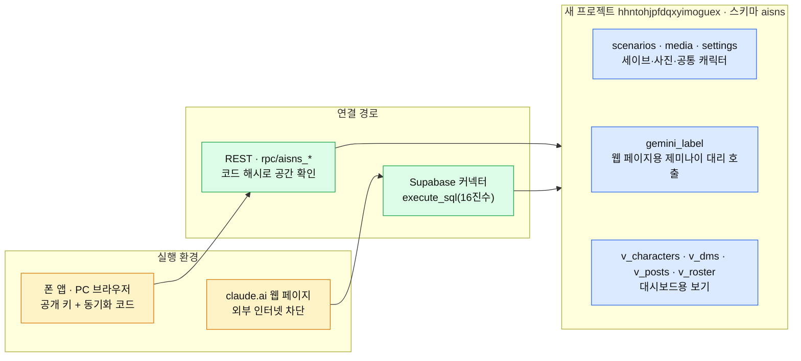

| 항목 | 내용 |
|---|---|
| **사용자가 할 일** | **없음.** 새 프로젝트에 스키마·함수·Gemini 키(vault)·라벨 `main` 설정 완료, `.env.local`도 새 주소로 교체 |
| 고친 오류 ① | 웹 페이지(커넥터) 응답 해석 실패 — 안내 문장 속 태그를 데이터로 오인 → 데이터 영역만 정확히 읽음 |
| 고친 오류 ② | 이모지가 반으로 잘린 글이 있으면 DB가 JSON을 거부(400)해 **동기화가 계속 실패** → 자를 때 이모지 보존 + 보내기 직전 자동 정리 |
| 올리기·받기 | 바뀐 세이브만 2.5초 뒤(웹 6초) · 받기는 앱 15초·웹 45초마다. 더 최신 수정이 이김 |
| 보안 | 테이블 직접 접근 차단(RLS), 동기화 코드는 해시로만 저장, Gemini 키는 vault(웹 페이지 코드에 키 없음) |
| 직접 보기 | Supabase 대시보드 → Table Editor → 스키마 `aisns` → `v_characters`·`v_dms`·`v_posts`·`v_roster` |
| DB 정의 | `supabase/aisns.sql` (적용 방법은 파일 맨 위 설명) |

## 8. 아이템·스탯 조정

| 아이템 | 효과 | 열기 |
|---|---|---|
| 🎁 선물 | 받는 사람·선물 고르기 → 쪽지로 전달 + 호감도·설렘 상승(관계·난이도 보정, 같은 날 반복 시 감소) → 답장 | 상단 날짜 누르기 |
| 🚀 바이럴 모먼트 | 다음 행동 1번을 크게 강화(글이면 반응 3~6배) | 〃 |
| ↩️ 되돌리기 | 방금 행동과 그 결과(답글·수치·시간)를 통째로 취소 | 〃 |
| ⏩ 시간 건너뛰기 | 몇 시간 또는 다음 날로 | 〃 |
| 스탯 조정 | 팔로워·아우라·유머·평판·레벨 직접 수정(팔로워가 많을수록 반응 폭발) | 나 탭 → 스탯 조정 |
| 난이도 | 쉬움·보통·어려움 — 오를 때·떨어질 때 배율 | 나 탭 |

## 9. 공통 캐릭터

| 항목 | 내용 |
|---|---|
| 무엇 | **내가 직접 넣는 계정 목록**. 어느 세계관에서든 `켜기`·`끄기`·`골라 넣기` |
| 넣는 법 | `새 계정 추가` 또는 `붙여 넣어 가져오기`(구글 시트·엑셀 표를 머리글까지 복사, 또는 JSON 배열) |
| 머리글 | 이름 · 아이디 · 성별(남/여) · 나이대 · 유형(셀럽·팬·친구…) · 팔로워(1.2만, 3,400, 1.5M) · 자기소개 · 특징 · 사진주소 (영어 머리글 name, handle… 도 됨) |
| 사진 | 사진 주소(URL) 또는 앨범에서 골라 크롭 |
| 끄면 | 그 세계관 캐스트에서 빠짐(지난 글은 남음). 같은 아이디로 다시 가져오면 내용만 갱신 |
| 동기화 | DB `settings`(목록) + `media`(사진)에 저장 → 폰·PC·웹 페이지 어디서든 같은 목록·사진(사진은 처음 한 번 받아 기기에 보관) |
| 들어 있는 것 | 사용자 제공 유명인 표의 **24명 + 사진 24장**(아이디 `celeb_…`). 성인물 배우 4행·신체 치수 열은 넣지 않음. 기본 등장 방식은 **꺼짐** → `켜기`(전체) 또는 `골라 넣기`로 이야기에 등장 |
| 역할 분담 | 앱은 **도구만** 제공합니다. 계정 정보·사진은 사용자가 준비해 넣습니다. 실존 인물을 넣는 경우 그 사람이 하지 않은 말·관계를 AI가 지어내므로, 공개·공유 시 초상권·명예 관련 책임은 사용자에게 있습니다 |
| 연애·성적 반응 | 공통 캐릭터(실존 인물일 수 있음)와 가족은 **연애 수위 설정과 무관하게 항상 연애·성적 반응 0**(팬·동료·가족으로만 반응). 설정으로 못 풀리는 고정 규칙입니다 |

## 10. 세계관·사진

| 세계관 | 한 줄 | 계정 수 |
|---|---|---|
| 🔌 뉴로맨서: 네오서울 | 깁슨 『뉴로맨서』 규칙의 사이버펑크 스프롤 | 25 |
| ⚽ 킥오프 | K리그 유망주 → 아시안게임 → 유럽 이적(가상 슈퍼스타) | 25 |
| 💼 사내연애 금지 | 판교 IT 회사 직장인 로맨스 | 25 |
| 🪖 여초부대 이등병 | 여성 징병 대체역사, 남성 지원병 로맨스 | 26 |
| 🎬 떡상할 때까지 | 구독자 0명에서 시작하는 현실 유튜버 | 25 |
| 📸 팔로워 0부터 | 현실 인플루언서 성장기(협찬·공구·저격) | 25 |

- 인물 설명: 핵심 인물은 **1~2문장(정체·성격·플레이어와의 관계)** + 처음 말투(`register`)만. 말투·이모지·말버릇 같은 세부 규칙은 적지 않습니다(친밀도에 따라 자연스럽게 달라지게).
- 세계관 파일에 남은 글: 시작 전 지난 글(`posts`)·이벤트 상황과 선택지(`events`)·환영 문구. 시작한 뒤의 글·답글·쪽지·이벤트 결과는 전부 AI가 씁니다.
- 기본 사진: AI 가상 얼굴 110장 + 얼굴 없는 프사 35장 + 장면 36장 + 배너 18장(전부 가상, 눈으로 검수, 미리 만들어 앱에 포함). 앱에서 사진 선택 → 크롭 → 저장, 바꾼 사진은 DB `media`에도 저장.
- 세계관 형식: `src/data/worldTypes.ts` · 사진 재생성: `python scripts/build_photos.py`

## 11. 게임 규칙 수치

```text
시간 흐름      글 +2시간 · 답글 +45분 · 쪽지 +20분 · 이벤트 +3시간  → 날짜가 바뀌면 하루 정산
경험치        글 12 · 답글 5 · 쪽지 4 · 이벤트 20 · 떡상 40 / 레벨업 필요 = 60 + (레벨-1)×40
평판          -100 ~ 100 · +35 이상 상승세 · -40 이하 논란 · -70 이하 캔슬(팔로워 30% 이탈)
난이도 배율    이벤트·선물  쉬움 ×1.8/×0.5 · 보통 ×1.5/×0.9 · 어려움 ×1.1/×1.4 (오를 때/떨어질 때)
              쪽지·답글·글 쉬움 ×1.7/×0.5 · 보통 ×1.4/×0.8 · 어려움 ×1.1/×1.2
이벤트 호감도   0이 아니면 최소 ±6 · 최대 ±30 / 설렘 최소 ±4 · 최대 ±25 / 정복도 최대 +25
한 번에 변화    호감도 ±25 · 설렘 ±20 · 정복도 ±15 (글·답글·쪽지 1회 기준 상한)
반응 수치      좋아요 ≈ 팔로워 × (약 1~10%) × 글 분위기 × 난이도 (바이럴 ×5~12, 바이럴 모먼트 ×3~6, 80만 넘으면 완만하게)
              조회수 ≈ 좋아요 × 18~45 / 답글 다발: 기본 5~6 · 인플루언서가 답하면 대댓글 2~3 · 최대 8 (남의 글 댓글도 같음)
행동 제한      없음(재화·에너지·광고 삭제)
```

- 숫자는 `src/game/rules.ts`·`difficulty.ts`·`engagement.ts`·`relationship.ts` 에서 바꿉니다.

## 12. 폴더 구조

| 경로 | 역할 |
|---|---|
| `App.tsx` | 시작점: 기기 데이터·공통 캐릭터·사용량 불러오기 → DB 동기화 → 화면 |
| `src/navigation/` | 스택 + 하단 탭 5개 |
| `src/screens/tabs/` | 홈·검색·알림·쪽지·**나(MeScreen)** |
| `src/screens/stack/` | 게시물·쪽지·이벤트·아이템·스탯 조정·공통 캐릭터·AI 연결·캐릭터 설정·**세계관 전체 수정(WorldEditScreen)** 등 |
| `src/components/` | 게시물 카드, 관계 칩·멘션 입력·자라는 숫자·수치 칩·드롭다운·**수치 슬라이더(StatSlider)**, 사진 크롭 |
| `src/game/` | 행동 처리(post·thread·dm·events), 관계·말투(relationship), 난이도, 반응 수치(engagement), 아이템·되돌리기, 공통 캐릭터 넣기(roster) |
| `src/ai/` | 프롬프트·문맥, 제미나이·클로드 연결, 응답 정리(normalize), `local/`(말투 판별·아이디·임시 계정 모양 — 문장 없음) |
| `src/store/` | 앱 상태(game), 공통 캐릭터(roster), **사용량·한 판 요금(usage)**, 기기 저장(내부 저장 키는 예전 접두어 `mainchar:` 유지 — 기존 데이터 그대로 읽기) |
| `src/sync/` | Supabase 동기화(REST·커넥터) + 웹 페이지용 제미나이 대리 호출 |
| `supabase/aisns.sql` | DB 스키마·함수·보기 정의 |
| `docs/screens/` | 이 문서의 화면 캡처 |

## 13. 검증·알려진 한계

**확인한 것 (자동 플레이, 실제 Gemini + Supabase)** — **v3.2 48개 항목**: 웹 빌드(사내연애 금지) **48/48** · 웹 페이지(아티팩트) 빌드(뉴로맨서, 가짜 claude 런타임으로 커넥터·DB 경유 Gemini 경로 확인) **47/48** — 남은 1개는 엄격한 단어 검사("미쳤냐")에 걸린 것으로 실제 답은 "미쳤냐 ㅋㅋㅋ / 아 얼굴 빨개졌잖아"(당황하며 좋아함) · 콘솔 오류 0 · HTTP 오류 0

**v3.3 재검증** — 위 48개 항목 **웹 빌드 48/48**(사내연애 금지) · 아티팩트 빌드 **회귀 0건**(DB 경유 Gemini 경로 포함) 재확인 + **연애 수위 전용 점검**: 같은 인물에게 순한맛→매콤함으로 올리고 같은 플러팅 보냄 → 설렘 상승폭 확대 확인(한 예: 43→60) · 매콤함도 신체·성 묘사 없이 밀당·만남 제안 수준 · **대화 요약**: 초반에 구체적 사실(고양이 알레르기)을 말하고 13턴 잡담 후 다시 물어보면, **요약 데이터에는 사실이 남음**(예: "해솔은 고양이 알레르기로 다른 장소를 찾기로 함") — 다만 캐릭터가 직접 답할 때는 성격상 장난스럽게 "모르는 척"할 수 있어 100% 그대로 티 나게 기억을 꺼내 보이진 않을 수 있음(아래 한계 참고)

- **반응 온도**: 썸 상대(사내연애 금지) 5명에게 같은 플러팅("근데 너 오늘 좀 귀엽더라") → 5명 모두 당황하면서 좋아함(예: "저 진짜 방금 심장 떨어질 뻔했어요 선배님 ㅠㅠ", "그럼 하늘 주임님도 저한테 넘어오신 건가요? ㅋㅋ"), **설렘 +10~14·호감 +7~11** · 동성 친구는 장난으로 받되 좋아하는 티
- **이벤트**: 시스템 글 0개 · 답 하나로 **4명** 수치 변화(예: 호감 +18·설렘 +9 → 아는 사이→매콤함) · 반응 글 2~3개, 전부 댓글 달림
- **슬라이더·세계관 전체 수정**: 한 줄 소개 저장 · 인증 계정 목록 · 호감도 +10·정복도 +5 저장 확인
- 첫 쪽지 AI 1회 · 글 1개 = AI 1회 · 답글 5~6개(최대 8) · 100만 팔로워 글도 8개 이하 · 남의 글 댓글 다시 열기 0회 · 다음 날 즉시 · 한 판 13회 호출(약 34원)
- 비밀값: 웹 페이지 번들에 키·주소·동기화 코드 0건

**한계**

- 연애·수위 있는 대화는 **설렘·밀당·스킨십 암시까지**(노골적인 성 묘사·신체 품평 없음). 매콤함 단계에서도 이 선은 그대로이며, 설정으로 더 올릴 수 없습니다. 정복도는 "뭐든 시킴"이 아니라 **안전 규칙 안에서** 부탁을 기꺼이 들어주는 정도. 실존 인물일 수 있는 공통 캐릭터와 가족은 연애 반응 없음(수위 설정과 무관).
- 쪽지 대화 요약은 **최선 노력**입니다. 긴 대화에서 말한 구체적 사실은 요약에 우선 보존되지만, 여러 번 재요약을 거치며 드물게 흐려질 수 있고, 캐릭터가 성격상 장난으로 모르는 척 답할 수도 있습니다 — "전체를 영원히 완벽하게 기억"을 보장하진 않습니다.
- AI 키가 없거나 AI가 계속 실패하면 캐릭터들이 반응하지 않습니다(맥락 없는 말로 채우지 않는 대신).
- 멀티플레이 없음(원본의 공유 타임라인·그룹 DM은 서버 필요).
- 같은 세이브를 두 기기에서 동시에 고치면 마지막에 저장한 쪽이 이김(합치기 없음).
- 사용량·요금은 이 기기에서 센 **추정치**(정확한 청구는 Google AI Studio).
- 안드로이드는 번들 빌드까지 확인. 실제 폰의 키보드 가림 등 세부 동작은 확인 필요.
- 이전 프로젝트(`hansy-daangn's Project`)의 `aisns` 스키마는 승인 전이라 지우지 않고 남겨 둠.
