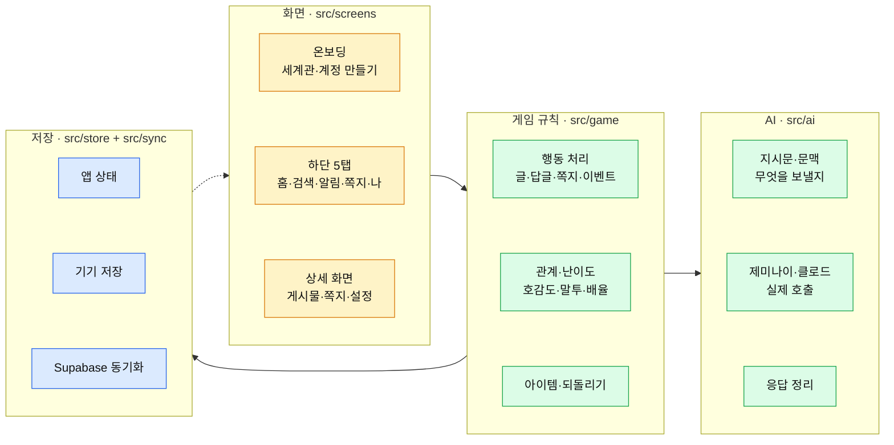

# AI-SNS — SNS 시뮬레이션 (React Native + Expo)

> 가상 인물들이 사는 SNS를 운영하는 시뮬레이션 앱. 글을 올리면 AI가 쓴 답글·댓글·쪽지가 달리고, 관계와 수치가 변합니다.
> 기본 세계관의 등장인물·사진은 **전부 가상 인물**입니다. 실존 인물은 앱이 만들지 않고, 사용자가 [공통 캐릭터](#5-공통-캐릭터-내가-넣는-계정)에 직접 넣어 씁니다.

## 빠르게 찾기

| 하고 싶은 것 | 섹션 |
|---|---|
| 지금 실행 | [1. 실행하기](#1-실행하기) |
| 폴더가 각각 무슨 역할인지 | [2. 파일 구조 — 각 부분의 역할](#2-파일-구조--각-부분의-역할) |
| 앱에서 설정 바꾸기 (코드 수정 없이) | [3. 앱 안에서 바꾸는 것](#3-앱-안에서-바꾸는-것) |
| 코드에서 값·문구 바꾸기 | [4. 코드에서 바꾸는 것](#4-코드에서-바꾸는-것) |
| 내 계정 목록 넣기 | [5. 공통 캐릭터](#5-공통-캐릭터-내가-넣는-계정) |
| DB 들여다보기·고치기 | [6. 저장·동기화 운영](#6-저장동기화-운영) |
| 사진 바꾸기 | [7. 사진 바꾸기](#7-사진-바꾸기) |
| 바꿀 수 없는 것 | [8. 고정 규칙](#8-고정-규칙-설정으로-못-바꿈) |
| 안 되는 것 | [9. 알려진 한계](#9-알려진-한계) |

---

## 1. 실행하기

쓰는 방식에 따라 세 가지입니다. **폰에서 상시로 쓸 거면 ① 또는 ②**, 개발·수정 중일 땐 ③.

| # | 방식 | 필요한 것 | 방법 |
|---|---|---|---|
| ① | **웹 주소로 접속** (가장 간단) | 없음 (정적 호스팅 1회) | `npx expo export -p web` → 생긴 `dist/` 폴더를 호스팅에 올림 → 폰 브라우저로 주소 접속 |
| ② | **폰에 앱으로 설치** | Expo 계정 | `npx eas build -p android --profile preview` → 나온 `.apk` 를 갤럭시에 설치 |
| ③ | **개발 중 미리보기** | PC + 폰에 Expo Go | `npm install` → `npx expo start` → QR 찍기 (폰·PC 같은 와이파이) |

- ①은 **홈 화면에 추가**하면 앱처럼 전체화면으로 뜹니다(`app.json` 의 `web` 설정 적용됨).
- ③은 PC에서 서버가 떠 있어야 폰이 붙습니다. PC 없이 쓰려면 ①이나 ②로 가세요.
- 와이파이가 다르면 ③은 `npx expo start --tunnel`.

**처음 실행 전 확인**

| 항목 | 내용 |
|---|---|
| AI 키 | **없으면 캐릭터가 반응하지 않습니다.** 나 탭 → AI 연결에서 Gemini 키 입력 (또는 `.env.local`) |
| 환경 변수 | `.env.local` 에 키·DB 주소가 들어갑니다. 없으면 `.env.example` 복사해서 채우기 |
| 공유할 때 | 코드를 남에게 줄 땐 **`.env.local` 을 빼고** `.env.example` 만 주세요 |

<p>
     
     
 
</p>

---

## 2. 파일 구조 — 각 부분의 역할

**색 범례**: 🟨 입력(화면) · 🟩 처리(규칙·AI) · 🟦 저장



### 루트 파일

| 경로 | 역할 |
|---|---|
| `.env.local` | **내 키 보관.** Gemini 키·Supabase 주소·동기화 코드 (공유 금지, git 제외됨) |
| `.env.example` | 위 파일의 빈 양식. 새로 받은 사람이 복사해서 채움 |
| `App.tsx` | 앱 시작점. 저장 데이터 불러오기 → 동기화 → 화면 |
| `app.json` · `package.json` | Expo 설정 · 의존성 |

### 소스 폴더

| 경로 | 역할 | 언제 여나 |
|---|---|---|
| `src/screens/tabs/` | 하단 5탭 화면 (홈·검색·알림·쪽지·나) | 탭 화면 배치를 바꿀 때 |
| `src/screens/stack/` | 상세 화면 (게시물·쪽지·이벤트·아이템·설정·세계관 수정) | 개별 화면을 고칠 때 |
| `src/screens/onboarding/` | 처음 시작 3단계 (세계관 고르기·내 계정·첫 팔로워) | 시작 흐름을 바꿀 때 |
| `src/components/` | 공용 부품 (게시물 카드·슬라이더·사진 크롭·멘션 입력) | 여러 화면에 공통 적용할 때 |
| `src/game/` | **게임 규칙.** 행동 처리·관계·난이도·수치·아이템 | 숫자나 규칙을 조정할 때 |
| `src/ai/` | **AI 지시문과 연결.** 무엇을 보내고 어떻게 받을지 | 캐릭터 말투·반응 성격을 바꿀 때 |
| `src/data/worlds/` | **세계관 6종.** 인물·시작 글·이벤트 | 세계관을 추가·수정할 때 |
| `src/store/` | 앱 상태와 기기 저장 | 거의 안 건드림 |
| `src/sync/` | Supabase 동기화 | 거의 안 건드림 |
| `src/types/` · `src/theme/` · `src/utils/` | 타입·색·공용 함수 | 거의 안 건드림 |

### 그 외

| 경로 | 역할 |
|---|---|
| `supabase/aisns.sql` | **DB 정의** (스키마·함수·보기). 적용법은 파일 맨 위 참고 |
| `assets/photos/` | 기본 사진 (가상 인물 얼굴·장면·배너) |
| `scripts/index_photos.py` | 사진을 바꾼 뒤 실행 → `src/data/photos.ts` 목록 갱신 |
| `docs/screens/` | 이 문서의 화면 캡처 |

---

## 3. 앱 안에서 바꾸는 것

코드를 고치지 않고 앱 화면에서 바로 조정합니다.

| 바꾸고 싶은 것 | 어디서 |
|---|---|
| **AI 키·모델** | 나 탭 → AI 연결 |
| **AI 사용량·요금 확인** | 나 탭 → AI 연결 → 사용량 |
| **연애 수위** (순한맛/보통/매콤함) | 나 탭 |
| **난이도** (쉬움/보통/어려움) | 나 탭 |
| **내 스탯** (팔로워·아우라·유머·평판·레벨) | 나 탭 → 스탯 조정 |
| **캐릭터 하나 고치기** (이름·소개·사진·관계 수치) | 캐릭터 프로필 → 수정하기 |
| **세계관 통째로 고치기** (설정·인물 전체) | 나 탭 → 세계관 전체 수정 |
| **공통 캐릭터 켜고 끄기** | 나 탭 → 공통 캐릭터 |
| **아이템 쓰기** (선물·바이럴·되돌리기·시간 건너뛰기) | 상단 날짜 누르기 |

---

## 4. 코드에서 바꾸는 것

| 바꾸고 싶은 것 | 파일 |
|---|---|
| **게임 수치** (시간·경험치·평판·변화 상한) | `src/game/rules.ts` |
| **난이도 배율** | `src/game/difficulty.ts` |
| **좋아요·조회수·답글 수** | `src/game/engagement.ts` |
| **관계 띠·말투 기준** | `src/game/relationship.ts` |
| **아이템 종류·효과** | `src/game/items.ts` |
| **AI 지시문** (캐릭터 성격·반응 방식) | `src/ai/prompts.ts` |
| **AI에게 보내는 정보** | `src/ai/context.ts` |
| **연애 수위 단계 이름·설명** | `src/game/content.ts` |
| **세계관 내용** | `src/data/worlds/*.ts` |
| **세계관 양식** (항목 추가) | `src/data/worldTypes.ts` |
| **DB 구조·함수** | `supabase/aisns.sql` |

바꾼 뒤 앱을 다시 실행하면 반영됩니다(③ 개발 미리보기는 저장만 해도 바로 반영).

---

## 5. 공통 캐릭터 (내가 넣는 계정)

어느 세계관에서든 쓸 수 있는 **내가 직접 넣는 계정 목록**입니다.

| 항목 | 내용 |
|---|---|
| 넣는 법 | 나 탭 → 공통 캐릭터 → `새 계정 추가` 또는 `붙여 넣어 가져오기` |
| 붙여넣기 형식 | 구글 시트·엑셀 표를 머리글까지 복사, 또는 JSON 배열 |
| 머리글 | 이름 · 아이디 · 성별 · 나이대 · 유형 · 팔로워 · 자기소개 · 특징 · 사진주소 |
| 사진 | 사진 주소(URL) 또는 앨범에서 골라 크롭 |
| 켜고 끄기 | `켜기`(전체) · `끄기` · `골라 넣기`. 끄면 캐스트에서 빠짐(지난 글은 남음) |
| 동기화 | DB에 저장 → 폰·PC 어디서든 같은 목록 |
| 책임 | 앱은 **도구만** 제공합니다. 실존 인물을 넣으면 그 사람이 하지 않은 말을 AI가 지어내므로, 공개·공유 시 초상권·명예 책임은 사용자에게 있습니다 |

---

## 6. 저장·동기화 운영

| 항목 | 내용 |
|---|---|
| **평소 할 일** | **없음.** 자동 저장·자동 동기화 |
| 동작 | 기기에 먼저 저장(오프라인 가능) → 바뀐 세이브만 DB로 올림. 더 최신 수정이 이김 |
| **DB 내용 보기** | Supabase 대시보드 → Table Editor → 스키마 `aisns` → `v_characters`·`v_dms`·`v_posts`·`v_roster` |
| **DB 구조 고치기** | `supabase/aisns.sql` 수정 후 적용 (방법은 파일 맨 위) |
| 보안 | 테이블 직접 접근 차단(RLS) · 동기화 코드는 해시로만 저장 · Gemini 키는 DB 금고(vault) |
| 동기화가 안 될 때 | `.env.local` 의 Supabase 주소·동기화 코드 확인 |

---

## 7. 사진 바꾸기

| 상황 | 방법 |
|---|---|
| **한 장만 바꾸기** (추천) | 앱에서 캐릭터 설정 → 사진 누르기 → 고르기·자르기 |
| 여러 장 교체 | `assets/photos/` 에 파일 넣은 뒤 `python scripts/index_photos.py` 실행 |
| AI로 새로 만들기 | 외부 생성 서비스로 만든 뒤 위 "여러 장 교체" 절차 |

---

## 8. 고정 규칙 (설정으로 못 바꿈)

| 규칙 | 내용 |
|---|---|
| 성 묘사·신체 묘사 | **모든 연애 수위 단계에서 사용하지 않음.** 매콤함도 설렘·밀당·스킨십 암시까지 |
| 공통 캐릭터·가족 | 연애 수위 설정과 **무관하게 연애·성적 반응 0**. 팬·동료·가족으로만 반응 |

사용자가 조절할 수 있는 부분(수위 3단계, 난이도, 관계 수치, 세계관 전체)은 전부 설정으로 열려 있습니다.

---

## 9. 알려진 한계

| 항목 | 내용 |
|---|---|
| AI 키 없으면 | 캐릭터가 반응하지 않습니다 (맥락 없는 틀 문장으로 채우지 않음) |
| 긴 대화 기억 | 최근 16줄 + 그 앞은 요약(최대 260자). **최선 노력**이며 완벽한 전체 기억은 아님 |
| 멀티플레이 | 없음 |
| 같은 세이브 동시 수정 | 마지막에 저장한 쪽이 이김 (합치기 없음) |
| 요금 표시 | 이 기기에서 센 **추정치**. 정확한 청구는 Google AI Studio |
| 안드로이드 | 번들 빌드까지 확인. 실제 폰 세부 동작은 확인 필요 |

---

<details>
<summary><b>내부 동작 — 관심 있을 때만 (운영에는 필요 없음)</b></summary>

### 역할 분담

- **AI는 글만 쓰고, 숫자는 게임 규칙이 정합니다**(범위 제한·난이도 배율).
- **기기는 문장을 만들지 않습니다.** 답글·댓글·쪽지·뉴스는 전부 AI가 씁니다.
- 글 1개 = AI 1회 호출. 답글 5~6개(최대 8)가 한 번에 돌아옵니다.

### 관계·말투 규칙 (`src/game/relationship.ts`)

| 항목 | 규칙 |
|---|---|
| 호감도 띠 | 적 < -55 ≤ 라이벌 < -15 ≤ 아는 사이 < 35 ≤ 친구 < 75 ≤ 베프 |
| 설렘(0~100) | 설렘 40↑ + 호감 20↑ → 매콤함 · 설렘 75↑ + 호감 60↑ → 연인 |
| 정복도(0~100) | 높을수록 부탁을 기꺼이 들어줌. 열혈 팬 40 · 팬 20 · 나머지 0에서 시작 |
| 말투 | 친구·베프·연인·가족 = 반말 · 아는 사이 = 해요체 · 단체 계정 = 격식체 |
| 오락가락 방지 | 경계를 8 넘게 넘어야 바뀜 + 하루 1번만 바뀜 |

### 게임 규칙 수치

```text
시간 흐름      글 +2시간 · 답글 +45분 · 쪽지 +20분 · 이벤트 +3시간
경험치        글 12 · 답글 5 · 쪽지 4 · 이벤트 20 · 떡상 40 / 레벨업 = 60 + (레벨-1)×40
평판          -100 ~ 100 · +35 이상 상승세 · -40 이하 논란 · -70 이하 캔슬(팔로워 30% 이탈)
난이도 배율    이벤트·선물  쉬움 ×1.8/×0.5 · 보통 ×1.5/×0.9 · 어려움 ×1.1/×1.4
              쪽지·답글·글 쉬움 ×1.7/×0.5 · 보통 ×1.4/×0.8 · 어려움 ×1.1/×1.2
한 번에 변화    호감도 ±25 · 설렘 ±20 · 정복도 ±15 (1회 상한)
반응 수치      좋아요 ≈ 팔로워 × (1~10%) × 글 분위기 × 난이도 / 조회수 ≈ 좋아요 × 18~45
```

### AI 토큰·요금 (실측, `gemini-3.5-flash-lite`)

| 기능 | 입력 | 출력 |
|---|---|---|
| 글 반응 | 약 4,500 | 약 700 |
| 남의 글 댓글 | 약 3,500 | 약 210 |
| 하루 정산 | 약 4,400 | 약 940 |
| 이벤트 결과 | 약 4,000 | 약 910 |
| 쪽지 | 약 2,700~3,300 | 약 40~110 |
| **한 판(13회)** | **약 45,000** | **약 4,300** |

모델별 한 판 요금(1달러=1,400원): `3.1-flash-lite` 약 25원 · **`3.5-flash-lite` 약 34원(기본)** · `3.8-flash` 약 70원 · `3.5-flash` 약 149원

### 세계관 6종

| 세계관 | 한 줄 | 계정 수 |
|---|---|---|
| 🔌 뉴로맨서: 네오서울 | 사이버펑크 스프롤 | 25 |
| ⚽ 킥오프 | K리그 유망주 → 유럽 이적 | 25 |
| 💼 사내연애 금지 | 판교 IT 회사 직장인 로맨스 | 25 |
| 🪖 여초부대 이등병 | 대체역사 군 로맨스 | 26 |
| 🎬 떡상할 때까지 | 구독자 0명 유튜버 | 25 |
| 📸 팔로워 0부터 | 인플루언서 성장기 | 25 |

</details>

<details>
<summary><b>검증 기록</b></summary>

- 자동 플레이 48개 항목 — 웹 빌드 **48/48** · 아티팩트 빌드 **회귀 0건** · 콘솔 오류 0 · HTTP 오류 0
- 연애 수위: 순한맛→매콤함으로 올리고 같은 플러팅 → 설렘 상승폭 확대 확인(43→60). 매콤함도 신체·성 묘사 없음
- 대화 요약: 초반 사실(고양이 알레르기)을 13턴 잡담 후에도 요약 데이터에 보존 확인
- 이벤트: 답 하나로 4명 수치 변화 + 반응 글 2~3개, 전부 댓글 달림
- 비밀값: 웹 번들에 키·주소·동기화 코드 **0건**

</details>

<details>
<summary><b>버전 변경 이력</b></summary>

**v3.3** — 연애 수위 3단계 직접 조절(나 탭) · 좋아하는 티를 사소하고 구체적인 디테일로 표현 · 쪽지 16줄 넘으면 앞부분 AI 요약 보관

**v3.2** — 반응 온도 확대(모두 크게 반응) · 플러팅에 적극 반응 · 스탯 3개(호감도·설렘·정복도) + 슬라이더 · 이벤트 답 → 여러 인물 수치 변화 + 반응 글 · 세계관 전체 수정 화면

**v3.1** — 틀 문장 0개(전부 AI 작성) · 반응 다발 최대 8개 · 하루 넘기기 즉시 · 모델별 한 판 요금 표시 · 사진 DB 저장

</details>

---

원본 앱 **status – 심즈 같은 SNS**(WishRoll)의 기능·화면 흐름을 재현한 공부용 클론입니다.
